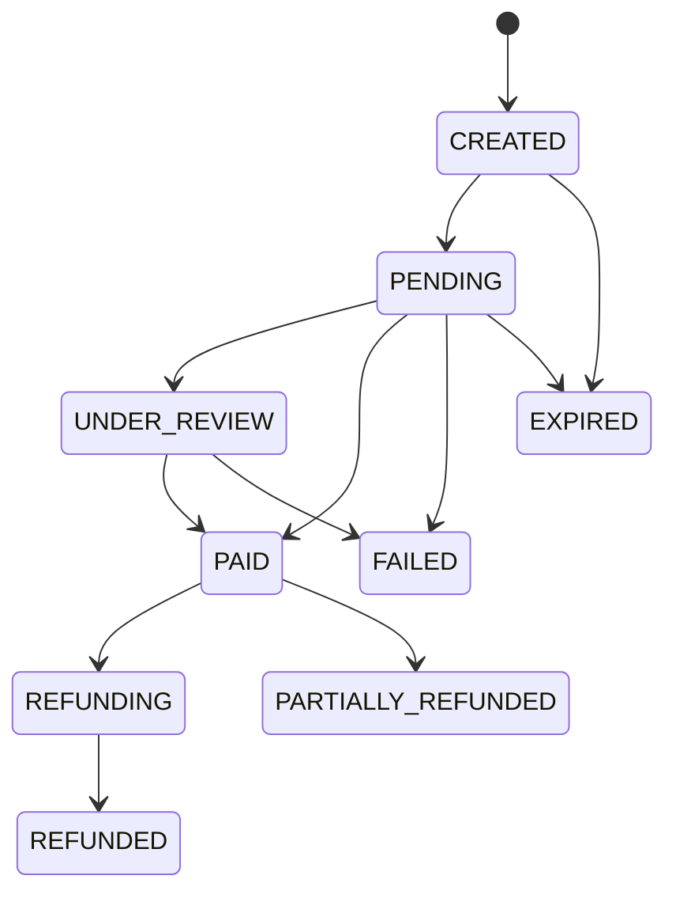
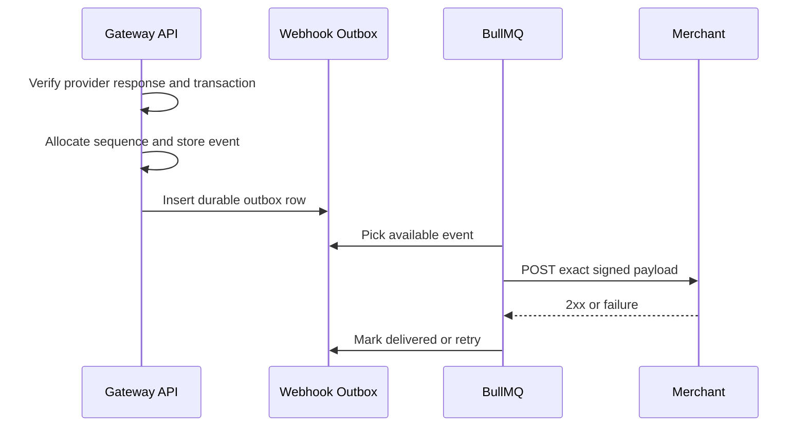

# Payment and Webhook Lifecycle

## Payment lifecycle

Valid transitions must be enforced in gateway code and recorded with actor, source and timestamp. Newer sequence numbers override older payment events; older sequences are archived but never applied backwards.

## Webhook lifecycle

Signature format is `X-Signature: t=<unix-seconds>,v1=<hex-hmac>`. The HMAC input is `<timestamp>.<exact_raw_body>`. Delivery must be retried with exponential backoff while retaining attempt history.
