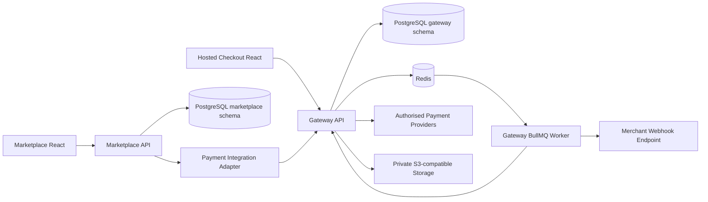
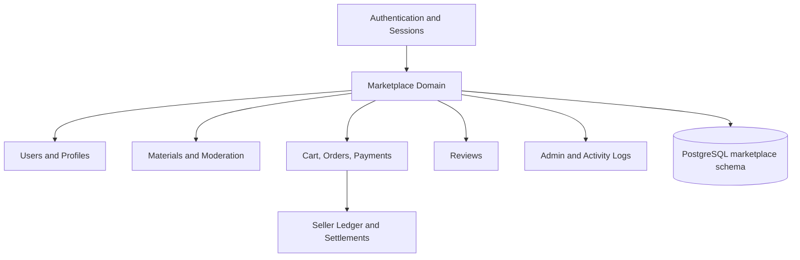
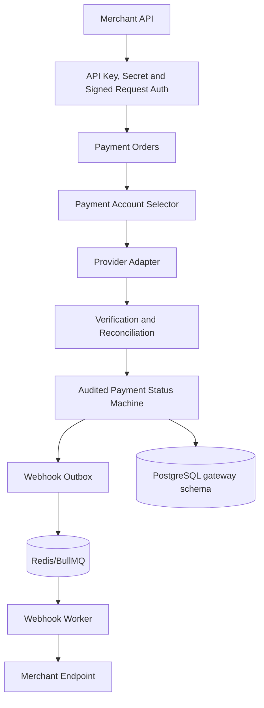
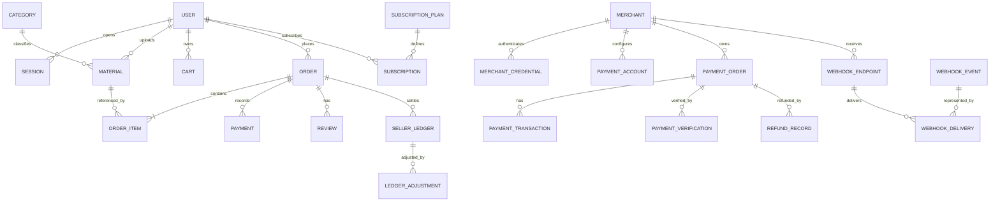
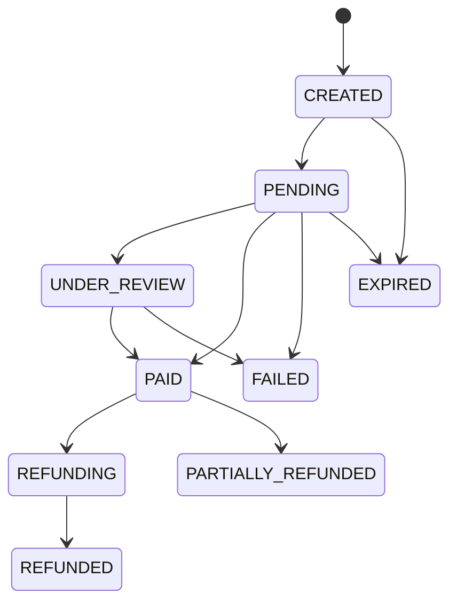
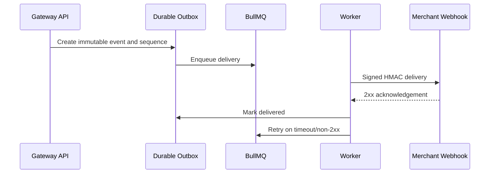

# Phase 5A Architecture Report

## System architecture



## Marketplace architecture



## Gateway architecture



## Database ER overview



## Payment lifecycle



Only cryptographically verified provider or approved manual-reconciliation evidence may cause the PAID transition. QR generation and browser redirects do not.

## Webhook lifecycle



## API communication specification

- Marketplace APIs remain under `/api/v1` and are authenticated for user operations.
- Gateway APIs use `X-Api-Key` and `X-Api-Secret`; signed timestamps and replay protection are added before activation.
- Marketplace backend calls gateway APIs through an isolated server-side adapter and never directly changes gateway tables.
- Gateway callbacks reach marketplace using raw bytes and timestamped HMAC signatures.
- Every webhook delivery carries environment, gateway order ID, internal order ID, event ID, sequence, amount and currency.
- Browser redirects are informational only and never complete an order or unlock a PDF.

## Monorepo migration plan

The final structure remains a controlled adaptation of the repository:

```text
noteora/
  apps/
    marketplace-web/     <- migrate client/
    marketplace-api/      <- migrate server/
    gateway-web/          <- create after gateway foundation approval
    gateway-api/          <- create in 5C
    gateway-worker/       <- create after BullMQ foundation approval
  packages/shared-types
  packages/shared-validation
  packages/shared-utils
  packages/payment-sdk
  infrastructure/docker
  infrastructure/nginx
  database/prisma
  database/migrations
  docs/
```

Before moving directories, both existing `client/` and `server/` remain buildable. Files should move only after imports, deployment scripts and CI paths are updated in one tested change.

## Existing endpoint inventory

Main endpoint families found in the existing Express application:

- `POST /auth/register`, `POST /auth/login`, `POST /auth/forgot-password`, `POST /auth/reset-password`
- `GET/PATCH /users/me`
- category create/list routes
- public/material seller upload and update/delete routes
- cart list/update routes
- order creation/status/list routes
- webhook and PDF download-token routes
- review create/list routes
- seller dashboard, materials, settlements and subscription routes
- admin users, orders, materials, reports, refunds, users/sellers/payments, subscriptions and activity routes

The migration does not alter these paths during Phase 5A.
